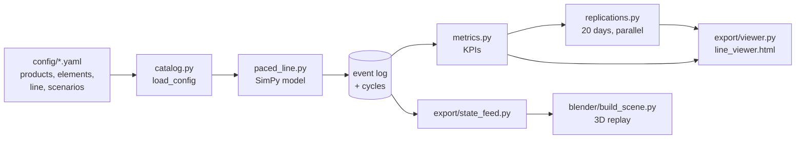

# Drone GA line — digital twin + discrete-event simulation

A paced General Assembly (GA) line for two FPV drone models (12 SKUs), modelled in **SimPy** and replayed as a
3D digital twin in **Blender**. The simulation is the source of truth: it writes an event log, KPIs, a
self-contained HTML viewer and a state feed that drives the 3D scene.

```
python -m pip install -e .[dev]
python run.py            # 4 scenarios x 20 simulated days, ~10 s -> out/
python -m pytest -q      # 32 tests
```

**Live viewer: https://luisravelo.github.io/drone-line-twin/** (same file as `docs/index.html`; regenerate locally as
`out/line_viewer.html`). **Live line** replays one day; **Report** compares scenarios.

## What is modelled

| Area | Model |
|---|---|
| Demand | Customer orders released at takt (demand-driven: 360 s = 80/day, 160 s = 180/day), SKU mix from YAML |
| Upstream (pull) | The order triggers the 3D print. Kanban cards = buffer slots (10): an order prints only when a card is free; the card returns when KUKA1 picks the frame. 2 printers -> KUKA2 -> paint conveyor through the booth -> accumulating buffer conveyor (constant speeds). The line does not start until 4 frames are buffered. |
| GA line | Skillets (AMRs) index together every takt (6 s index). Stations run their work elements in parallel; a station still working at takt stops the whole line (andon), and the stop is charged to the last finisher. |
| Work content | Per element and per fastener rundown: lognormal (manual, CV 0.3-0.4) / normal (automated, floored) |
| Quality | Torque NOK -> re-hit; kitting colour error (controller colour must match the frame) caught at final inspection -> off-line repair bay |
| Statistics | Common random numbers per asset (`seed` x asset name); 20 independent days per scenario |

## Scenarios (`config/scenarios/*.yaml`, 20 simulated days each)

| Scenario | Positions | Takt | Shipped/day | JPH | Takt attainment | Balance loss | Line stop/day | Bottleneck |
|---|---|---|---|---|---|---|---|---|
| baseline | 8 | 360 s | 78.0 | 9.75 | 99.9 % | 78.9 % | 1 s | ST10 |
| consolidated | 4 | 360 s | 79.6 | 9.95 | 95.7 % | 57.5 % | 83 s | ST10 |
| growth_8pos | 8 | 160 s | 138.6 | 17.32 | 2.0 % | 51.4 % | 6 024 s | ST10 |
| growth_6pos | 6 (rebalanced) | 160 s | 175.0 | 21.87 | 81.4 % | 35.1 % | 603 s | ST30 |

Reading: at growth demand the original 8-position line cannot make takt (ST10 is over 100 % takt load and stops
the line almost every cycle); rebalancing to 6 positions at <= 85 % load recovers ~97 % of demand, with ST30
(controller + antennas) as the new constraint.

**Takt load** = work / time available per takt (plan, can exceed 100 %). **Utilization** = busy / actual elapsed
(capped at 100 %, because line stops stretch the cycle).

## Architecture



| Module | Responsibility |
|---|---|
| `src/dronetwin/distributions.py` | Seeded RNG streams and the time distributions declared in YAML |
| `src/dronetwin/catalog.py` | Products, SKUs, kits (colour-matched controller), stations, assets; scenario loading |
| `src/dronetwin/paced_line.py` | The DES: order release, pull upstream, paced line, andon, quality, repair, skillets |
| `src/dronetwin/metrics.py` | KPIs from the event log (JPH, takt attainment, stops by station, takt load vs utilization, balance loss, quality) |
| `src/dronetwin/replications.py` | Independent days in parallel processes (results do not depend on the worker count) |
| `src/dronetwin/export/viewer.py` | Single-file HTML viewer (live replay + report, CSV export) |
| `src/dronetwin/export/state_feed.py` | Compact per-unit / per-skillet / per-station timeline for the 3D replay |
| `run.py` | Runs all scenarios, writes `out/` (CSV, JSON, HTML) |

A new scenario is a new YAML file (takt, positions, mix, quality rates, pull parameters); no code change.

## 3D digital twin (Blender 5.2)

`blender/build_scene.py` rebuilds the whole scene from `out/state_feed_growth_6pos.json` (one 8.5 h shift,
24 481 frames at 30x, playable in the viewport):

- Print -> KUKA2 -> paint conveyor -> 10-slot buffer -> KUKA1 (Fusion joint axes, IK poses) -> AMR skillets on
  T-slot benches -> ST50 inspection -> packing / repair; AMR return track with transfers at ST00 and ST50.
- Parts appear on the drone at the sim's element starts; rigged Dummy 13 operators (armature + 2-bone IK) walk
  to lineside totes; min/max inventory with a 10-min milk run, a backstock mini-warehouse with forklift and a
  controller sequencing cell (ST30 receives controllers in build sequence).
- Floor zones follow the plant colour system (assembly, logistics, buffer, quality, lineside, route, movers).
- CAD: Fusion 360 -> USDZ (`cad/usd/`), ready for Omniverse.

Module map: `build_scene.py` (layout, line, KUKA1, skillets) · `kuka_rig.py` · `dummy_rig.py` · `actors.py`
(operators, inspector) · `upstream_ui.py` (WIP flow, HUD process blocks) · `logistics.py` (totes, milk run,
warehouse, forklift, sequencing) · `zones.py` · `lib_*.py` (one-time asset prep).

## Repo layout

```
config/          YAML: products, elements, lines, scenarios
src/dronetwin/   simulation, metrics, exports
tests/           pytest (determinism, event order, pull, growth, metrics, state feed)
run.py           entry point
blender/         3D twin builder scripts (+ drone_line_twin.blend, not in git)
cad/             meshes, USDZ, renders (STEP sources not in git)
docs/            design spec, plans, BOM, gemba review
out/             generated (not in git)
```
